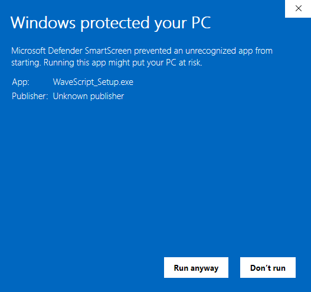

# WaveScript

**Расшифровка аудио и видео в текст и субтитры для Windows 10 и 11. Всё считается на вашем компьютере: записи никуда не загружаются.**

Сайт: **[wavescript.vinceandbyte.fun](https://wavescript.vinceandbyte.fun/)** · [Скачать последнюю версию](https://github.com/ikuruhixohef89-tech/wavescript/releases/latest/download/WaveScript_Setup.exe)

## Что умеет
- Превращает лекции, интервью, подкасты, созвоны и голосовые сообщения в текст.
- Работает без интернета (интернет нужен только чтобы скачать программу и модель распознавания, активировать Pro и проверять обновления).
- Понимает MP3, WAV, M4A, OGG, FLAC, AAC, WMA, MP4, MKV, MOV, AVI, WEBM и другие форматы. У фильмов с несколькими звуковыми дорожками можно выбрать нужную.
- Для русской речи использует модель GigaAM от Сбера, она быстро работает даже без видеокарты. Для других языков (английский, украинский, немецкий и около 15 всего) есть модели Whisper. Язык можно определить автоматически, расшифровку можно сразу перевести на английский.
- Использует видеокарту NVIDIA, если она есть (ускорение до ~30× от длины записи; на обычном процессоре русская речь с GigaAM до ~10×; замеры автора на одном компьютере, у вас будет иначе).
- Интерфейс на русском и английском, программа сама сообщает об обновлениях.

## Бесплатно и Pro
- **Бесплатно:** первые 15 минут каждой записи, все модели распознавания, текст (TXT) и копирование.
- **Pro:** запись любой длины, субтитры SRT и VTT, очередь из нескольких файлов, экспорт в Word (DOCX) и JSON. Разовая покупка, лицензия бессрочная, без подписки, ключ работает на двух компьютерах. Цена и покупка на [сайте](https://wavescript.vinceandbyte.fun/).

## Установка
1. Скачайте `WaveScript_Setup.exe` из [последнего релиза](https://github.com/ikuruhixohef89-tech/wavescript/releases/latest) и запустите (около 59 МБ).
2. **Если Windows показывает «Система Windows защитила ваш компьютер»** (Windows protected your PC): установщик пока не подписан платным сертификатом. Нажмите **«Подробнее»** (More info), затем **«Выполнить в любом случае»** (Run anyway).

3. При первом запуске программа один раз скачает модель распознавания (от 140 МБ до 1,5 ГБ, в зависимости от выбранной). Кнопка «Попробовать на примере» на пустом экране покажет результат за несколько секунд.

Проверка файла: SHA-256 и результат VirusTotal для каждой версии указаны на [сайте](https://wavescript.vinceandbyte.fun/) и в описании релиза.

## Если что-то не работает
- В окне программы нажмите значок «Сообщить о проблеме»: программа подготовит письмо с диагностикой (без ваших записей и без текста расшифровок), вы сами решаете, отправлять ли его.
- Или напишите на почту поддержки, адрес указан на [сайте](https://wavescript.vinceandbyte.fun/) и в письме из программы.
- Новости и вопросы: [группа ВКонтакте](https://vk.com/wave_script) или вкладка Issues этого репозитория.

## Документы
- [Оферта и политика конфиденциальности](OFERTA.md)
- Страницы на сайте: [руководство «Расшифровка аудио без интернета»](https://wavescript.vinceandbyte.fun/rasshifrovka-audio-bez-interneta/), [расшифровка голосовых сообщений](https://wavescript.vinceandbyte.fun/rasshifrovat-golosovoe-soobshchenie/), [субтитры к видео](https://wavescript.vinceandbyte.fun/subtitry-k-video/)

---

## English
**WaveScript** turns audio and video recordings (lectures, interviews, podcasts, calls, voice messages) into text and subtitles, entirely offline on your Windows 10/11 PC. Nothing is uploaded. It uses Sber's GigaAM model for Russian and Whisper models for about 15 other languages, with optional NVIDIA GPU acceleration. The free version transcribes the first 15 minutes of each recording; Pro (one-time purchase, perpetual licence) removes the limit and adds SRT/VTT subtitles, a file queue and Word/JSON export.

Website (Russian): https://wavescript.vinceandbyte.fun/ · Download: [latest release](https://github.com/ikuruhixohef89-tech/wavescript/releases/latest). The installer is not signed with a paid code-signing certificate yet, so Windows SmartScreen may ask for confirmation ("More info" → "Run anyway").
