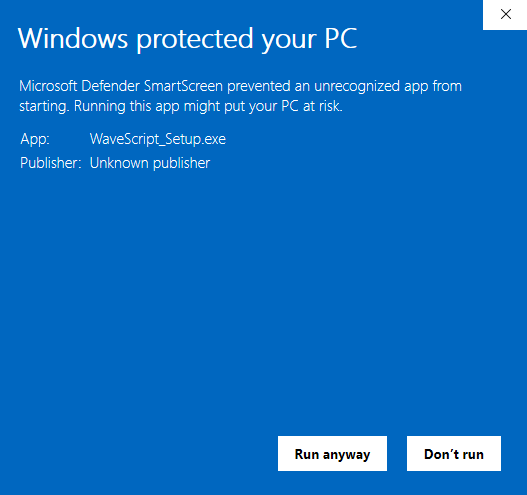

# WaveScript

Расшифровка аудио и видео в текст и субтитры для Windows 10 и 11. Работает на вашем компьютере: записи никуда не отправляются.

**[Скачать последнюю версию](https://github.com/ikuruhixohef89-tech/wavescript/releases/latest/download/WaveScript_Setup.exe)**

- Понимает MP3, WAV, M4A, MP4, MKV и другие форматы.
- Сохраняет текст и субтитры (SRT, VTT).
- Использует видеокарту NVIDIA, если она есть.
- Интерфейс на русском и английском, обновляется сама.

**Если Windows показывает «Система Windows защитила ваш компьютер»** (Windows protected your PC): это потому, что установщик не подписан платным сертификатом.

1. Нажмите **«Подробнее»** (More info) под текстом предупреждения.
2. Появится кнопка **«Выполнить в любом случае»** (Run anyway), нажмите её.

**Первый запуск:** программа один раз скачает модель распознавания (от 140 МБ до 1,5 ГБ, в зависимости от выбранной). Без видеокарты NVIDIA длинные записи расшифровываются примерно со скоростью самой записи, окно можно свернуть.

**Что-то не работает?** Нажмите значок сообщения вверху окна программы или напишите в [бота](https://t.me/WaveScriptSupport_bot).

Новости и вопросы: [группа ВКонтакте](https://vk.com/wave_script) или вкладка Issues.

[Оферта и политика конфиденциальности](OFERTA.md)
